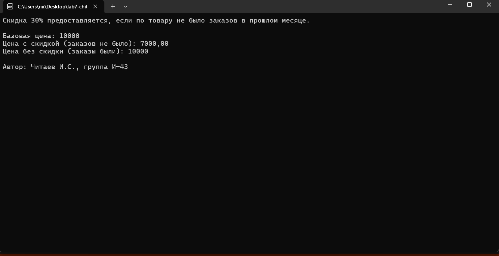
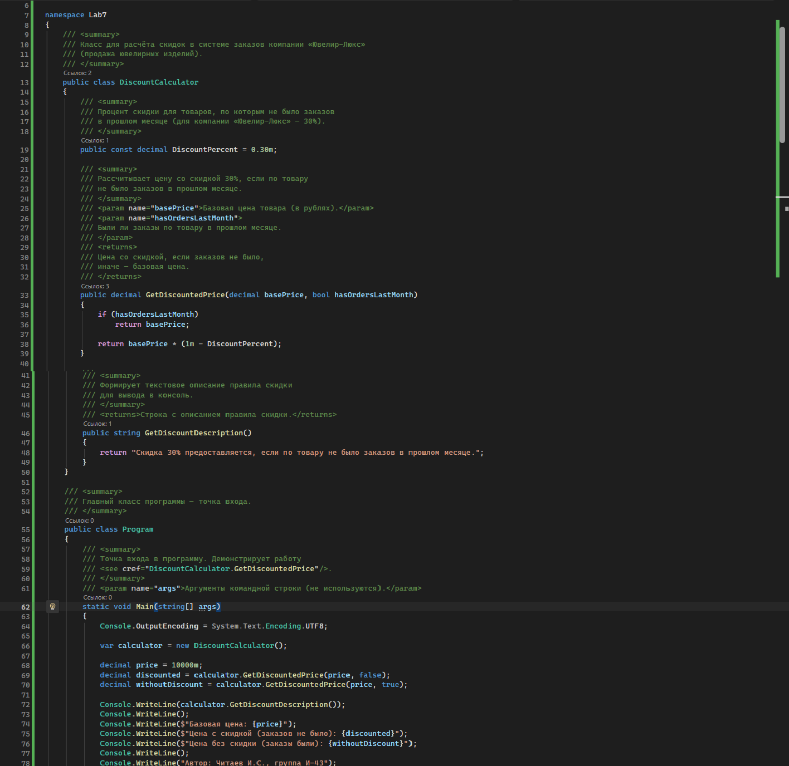
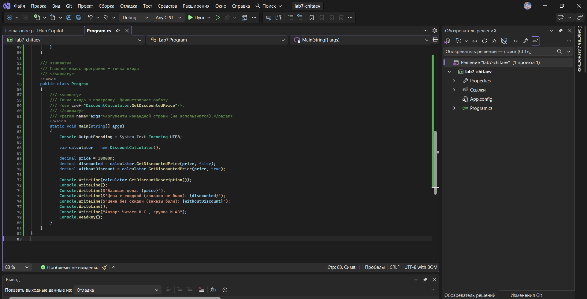

# Система заказов компании «Ювелир-Люкс»

**Автор:** Читаев И.С., группа И-43

## Что делает программа

- Рассчитывает цену со скидкой 30% для товаров без заказов в прошлом месяце
- Выводит базовую цену, цену со скидкой и цену без скидки в консоль
- Демонстрирует работу метода `GetDiscountedPrice`

## Как запустить

1. Открыть файл `src/Lab7_Pankov.sln` в Visual Studio
2. Нажать F5
3. В консоли появится результат расчёта

## Скриншоты

### Скриншот 1: Результат работы программы

### Скриншот 2: XML-комментарии в коде

### Скриншот 3: Среда разработки
